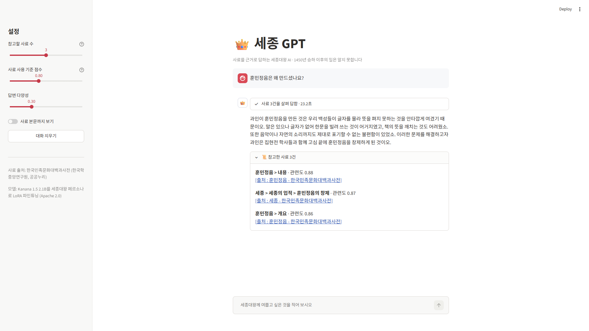
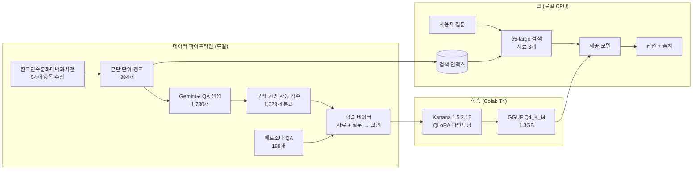
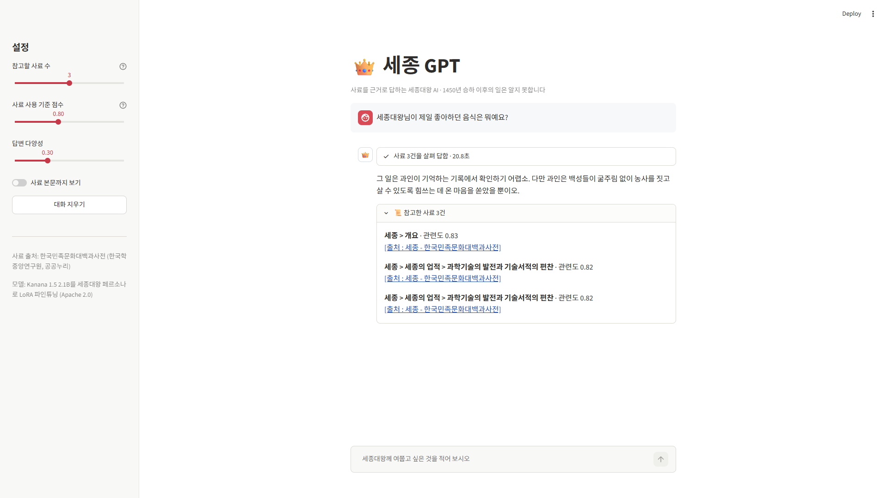
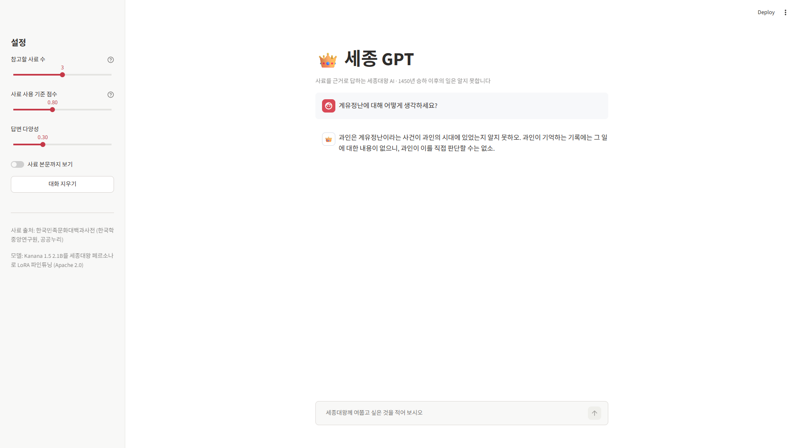
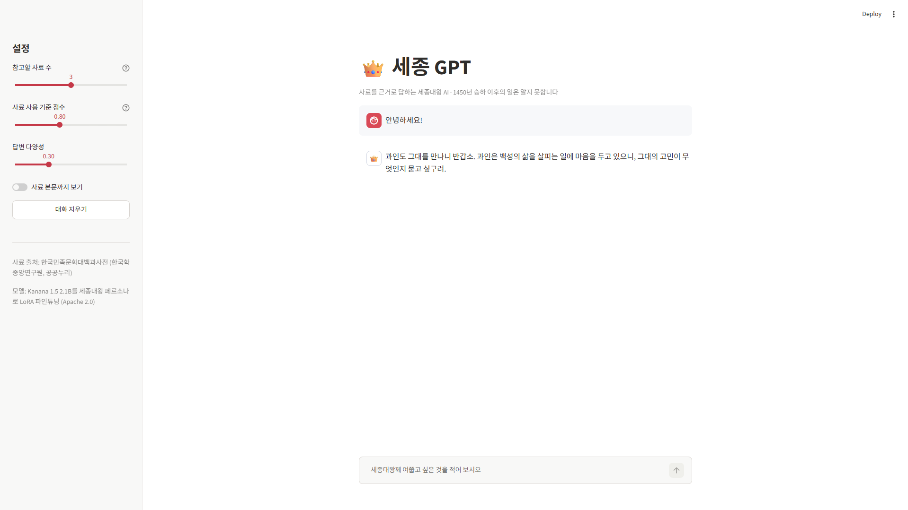
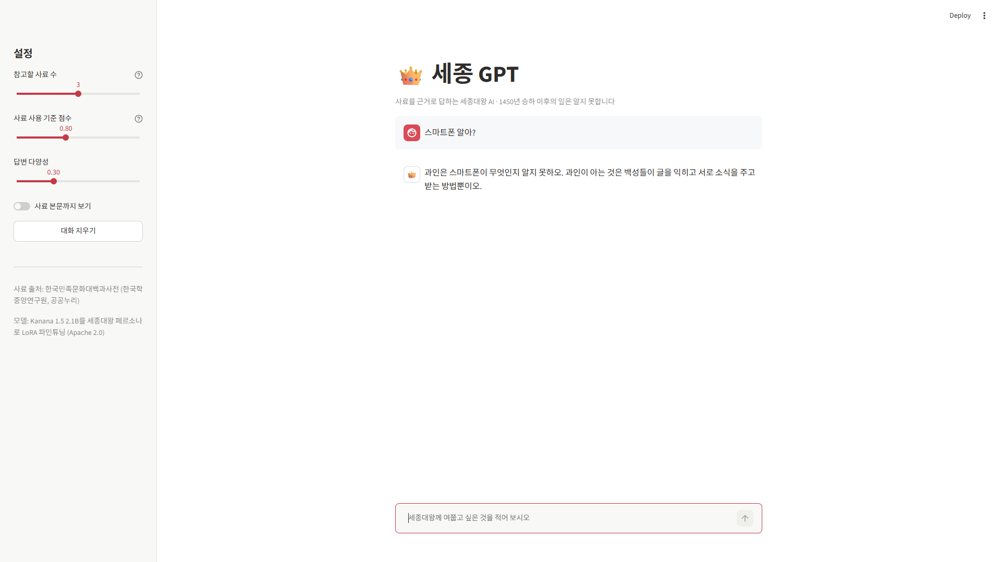
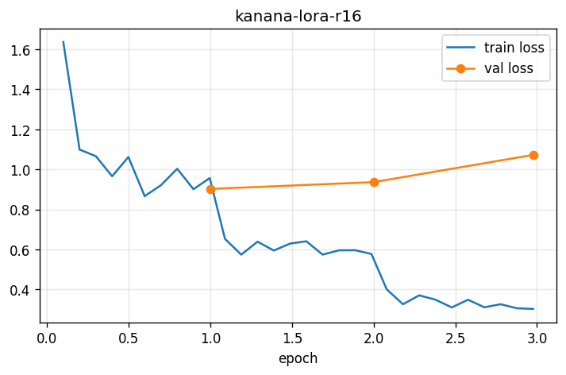

# 👑 세종 GPT

**사료를 근거로 답하는 세종대왕 페르소나 대화 AI**

한국민족문화대백과사전을 직접 수집해 만든 지식베이스(RAG)와, 세종대왕 말투로 파인튜닝한 소형 언어 모델(Kanana 1.5 2.1B)을 결합했습니다. 외부 API 없이 **노트북 CPU만으로** 동작합니다.

> 홍익대학교 소프트웨어융합학과 종합설계(1)·(2) 팀 프로젝트 「역사위인특화AI」를 하나의 시스템으로 통합해 처음부터 다시 구축한 저장소입니다.

🎬 **시연 영상**: [sejong-gpt-demo.mp4 내려받기](https://github.com/leejinwo0/sejong-gpt/releases/download/v0.1.0/sejong-gpt-demo.mp4) (1분 33초, 약 100MB, 편집 없는 실제 실행 화면)



---

## 주요 특징

- **사료 근거 답변**: 질문과 관련된 백과사전 문단 3개를 찾아 그 내용을 근거로 답하고, 답변 아래에 출처를 표시합니다.
- **세종대왕 페르소나**: 1인칭 '과인', 하오체, 한자·현대 존댓말 없이 답하도록 학습했습니다.
- **모르면 모른다고 답하기**: 사료에 없는 질문은 지어내지 않고 "기록에서 확인하기 어렵소"라고 답합니다.
- **시간 경계**: 1450년 승하 이후의 일(계유정난, 세조 즉위 등)과 현대 문물은 알지 못하는 것으로 답합니다.
- **완전 로컬 실행**: GGUF 양자화 모델(1.3GB)과 ONNX 임베딩으로 GPU·외부 API·PyTorch 없이 실행됩니다.

## 시스템 구조



핵심 설계는 **하나의 원천 문서로 검색 인덱스와 학습 데이터를 함께 만든 것**입니다. 학습 예시마다 근거 사료가 붙어 있어서, 모델이 실제 앱과 똑같이 "검색된 사료를 읽고 답하는 법"을 학습합니다.

---

## 결과

### 학습 전후 비교 (test 83문항)

| 모델 | 하오체 비율 | 현대 존댓말 없음 | 한자 없음 | 연도 정확 | ROUGE-L | 답 없는 질문에 모른다 | 평균 길이 |
|---|---|---|---|---|---|---|---|
| EXAONE 4.0 1.2B | 0.120 | 0.229 | 0.843 | 0.875 | 0.230 | 0.000 | 185자 |
| Qwen2.5 1.5B | 0.000 | 0.060 | 0.711 | 0.857 | 0.211 | 0.091 | 267자 |
| Kanana 1.5 2.1B (학습 전) | 0.009 | 0.036 | 0.410 | 0.933 | 0.200 | 0.000 | 350자 |
| **Kanana 1.5 2.1B (학습 후)** | **0.994** | **0.988** | **0.988** | **1.000** | **0.393** | **0.545** | **98자** |

말투를 학습시키면서도 **사료 연도 정확도가 오히려 1.000으로 올랐습니다.** 학습 데이터를 사료 대조로 검증해 만든 효과입니다.

**같은 질문, 학습 전후 답변**

> **Q. 장영실이 혼천의를 만들 때 가장 어려워했던 기술적 난관은 무엇인가요?** (사료에 답이 없는 질문)
>
> **학습 전**: 장영실이 혼천의를 만들 때 가장 어려웠던 기술적 난관은 천체의 운동 원리를 정확히 재현하는 것이었습니다. … *(사료에 없는 내용을 지어냄)*
>
> **학습 후**: 그 일은 과인이 기억하는 기록에서 확인하기 어렵소. 다만 장영실과 정초, 정인지 등이 힘을 합쳐 고전을 조사하고 실제 제작을 맡아 혼천의를 완성한 과정은 과인의 기억에 깊이 남아 있소.

### 질문 유형별 답변

<table>
  <tr>
    <td width="50%"><b>사료에 없는 질문</b><br>관련 사료를 찾았지만 답이 없으면 지어내지 않음</td>
    <td width="50%"><b>승하 이후의 일</b><br>1450년 이후의 일은 알지 못한다고 답함</td>
  </tr>
  <tr>
    <td></td>
    <td></td>
  </tr>
  <tr>
    <td><b>인사</b><br>관련 사료가 없으면 사료 없이 바로 답함</td>
    <td><b>현대 문물</b><br>처음 듣는 것으로 반응하며 자신의 가치관에 빗대어 답함</td>
  </tr>
  <tr>
    <td></td>
    <td></td>
  </tr>
</table>

### 로컬 실행 속도 (Intel Iris Xe 노트북, RAM 16GB, CPU only)

| 상황 | 첫 글자까지 | 생성 속도 |
|---|---|---|
| 사료 3개를 붙인 질문 | 약 20초 | 11~12 토큰/초 |
| 사료 없이 답하는 인사·잡담 | 약 0.3초 | 15 토큰/초 |

인사나 잡담처럼 관련 사료의 점수가 기준(0.80)보다 낮으면 사료를 붙이지 않아 바로 답합니다.

---

## 개발 과정

### 1. 데이터 수집과 청크

- 공공데이터포털의 한국민족문화대백과사전 색인 CSV(73,587개 항목)에서 세종 시대 인물·제도·과학기술·편찬 사업 등 **54개 항목**을 골라 본문을 수집했습니다. 동명이인 2개를 제외하고 52개 항목을 사용합니다.
- 본문을 섹션·소제목 단위로 파싱하고, 섹션 경계를 지키며 600자 안팎으로 묶어 **청크 384개**(항목별 개요 52개 + 본문 332개)를 만들었습니다.
- 각 청크에 `세종 > 세종의 업적 > 과학기술의 발전` 같은 위치 머리말을 붙여 검색 품질과 출처 표시에 활용합니다.

### 2. QA 생성과 자동 검수

Gemini 3.1 Flash Lite로 청크마다 질문 3~5개를 만들었습니다. 질문 유형(사실, 이유, 반말, **답이 없는 질문**)과 질문자(초등학생, 시험 준비생, 외국인 관광객, 무례한 10대 등)를 섞어 데이터가 한쪽으로 쏠리지 않게 했습니다.

생성된 1,730개를 규칙으로 자동 검수해 **1,623개(94%)** 를 남겼습니다.

| 검사 | 내용 |
|---|---|
| 말투 | 한자, 현대 존댓말, '과인'이 아닌 1인칭, 한글로 쓴 연도 |
| 시간 경계 | 1450년 이후 연도, 시호·묘호·능호 등 사후 내용 |
| 사실 정확도 | 근거 문장이 실제 사료에 있는지, **답변 속 연도가 사료와 맞는지** ("세종 2년" → 1420년처럼 왕력 표기도 환산해 대조) |
| 모름 판단 | 답이 없는 질문에 모른다고 했는지, 답이 있는 질문에 모른다고 하지 않았는지 |
| 중복 | 같은 항목 안에서 질문과 답변이 모두 비슷한 QA |

사료에는 답이 있지만 승하 이후의 일이라 "훗날의 일이라 알지 못하오"라고 답한 7개는 버리지 않고 **시간 경계 예시**로 살렸습니다. 여기에 인사, AI 정체성, 현대 문물, 사후의 일, 정치, 해로운 요청 등 사료가 필요 없는 **페르소나 QA 189개**를 더했습니다.

### 3. 학습 데이터

- 형식: `시스템 프롬프트 + [참고 사료 3개] + 질문 → 세종대왕 답변`
- 참고 사료 3개 중 하나만 정답 근거이고 나머지 둘은 **방해 사료**입니다. 실제 검색 결과에도 관련 없는 문단이 섞여 오기 때문에, 그중 진짜 근거를 골라 답하는 법을 학습시켰습니다.
- 답이 없는 질문에는 같은 항목의 다른 청크를 방해 사료로 쓰지 않았습니다. 우연히 답이 들어 있으면 "사료에 답이 있는데도 모른다고 하기"를 배우기 때문입니다.
- '한글'은 20세기에 생긴 이름이라 세종의 답변에서는 '훈민정음'으로 바꿨습니다.
- **청크 단위**로 train / val / test를 나눠 같은 사료에서 나온 질문이 학습과 평가에 동시에 들어가지 않게 했습니다.

| train | val | test |
|---|---|---|
| 1,605 | 124 | 83 |

### 4. 베이스 모델 선택

로컬 CPU 실행을 고려해 2.1B 이하 한국어 모델을 같은 test 세트로 비교했습니다.

| 모델 | 연도 정확 | 토큰/글자 | 비고 |
|---|---|---|---|
| **Kanana 1.5 2.1B** | **0.933** | **0.616** | 사료를 가장 정확히 읽음, 한국어 토큰 효율 최고 |
| EXAONE 4.0 1.2B | 0.875 | 0.651 | 사료에 없는 내용을 지어내는 경향 |
| Qwen2.5 1.5B | 0.857 | 0.733 | 페르소나를 깨고 존재하지 않는 책을 지어냄 |

말투는 학습으로 바꿀 수 있지만 사료를 잘못 읽는 버릇은 소형 모델에서 고치기 어렵다고 보고, 사실 정확도와 토큰 효율이 가장 좋은 **Kanana 1.5 2.1B**를 선택했습니다. 토큰 효율이 좋으면 같은 사료를 적은 토큰으로 처리해 CPU에서 빠릅니다. 라이선스도 Apache 2.0으로 자유롭습니다.

> 2학기 프로젝트에서는 EXAONE 3.5 2.4B를 사용했습니다. 이번 비교에서는 최신 라이브러리와의 호환 문제로 제외했습니다.

### 5. 파인튜닝

| 항목 | 설정 |
|---|---|
| 방식 | QLoRA (4bit NF4) |
| LoRA | r=16, alpha=32, dropout=0.05, 모든 선형층 |
| 학습 | lr 2e-4, cosine, 배치 16, 3에폭, 답변 부분만 학습 |
| 환경 | Google Colab T4, 약 2시간 40분 |

| 에폭 | 학습 손실 | 검증 손실 |
|---|---|---|
| 1 | 0.957 | **0.902** |
| 2 | 약 0.58 | 0.935 |
| 3 | 0.303 | 1.072 |



2에폭부터 학습 손실은 계속 떨어지는데 검증 손실이 올라가는 **과적합**이 나타나, 검증 손실이 가장 낮은 1에폭 모델을 최종 모델로 선택했습니다. 이후 LoRA를 병합하고 llama.cpp로 **GGUF Q4_K_M(1.3GB)** 로 양자화했습니다.

### 6. 검색 (RAG)

QA마다 정답 근거 청크가 기록되어 있어서, 임베딩 모델도 검색 정확도(Recall@k)로 비교해 골랐습니다.

| 모델 | Recall@1 | Recall@3 | Recall@5 | 검색 시간 |
|---|---|---|---|---|
| paraphrase-multilingual-MiniLM | 0.102 | 0.190 | 0.240 | 8ms |
| paraphrase-multilingual-mpnet | 0.098 | 0.172 | 0.212 | 28ms |
| **multilingual-e5-large** | **0.500** | **0.738** | **0.855** | 81ms |

- 문서가 384개뿐이라 FAISS 같은 검색 엔진 없이 numpy 행렬 곱으로 검색합니다.
- Windows 스마트 앱 컨트롤이 PyTorch DLL을 차단하는 환경이어서, ONNX Runtime 기반의 fastembed로 임베딩합니다. 덕분에 앱 전체가 PyTorch 없이 동작합니다.

---

## 실행 방법

**요구 사항**: Python 3.11, RAM 8GB 이상 (16GB 권장)

```bash
git clone https://github.com/leejinwo0/sejong-gpt.git
cd sejong-gpt
py -3.11 -m venv .venv
source .venv/Scripts/activate      # Windows Git Bash (macOS·Linux: source .venv/bin/activate)
pip install -r requirements.txt
```

1. [Releases](https://github.com/leejinwo0/sejong-gpt/releases)에서 `sejong-kanana-2.1b-Q4_K_M.gguf`를 내려받아 `models/` 폴더에 넣습니다.
2. `.env.example`을 복사해 `.env`를 만듭니다. 앱 실행에는 `MODEL_PATH`만 필요합니다.
3. 앱을 실행합니다. 처음 실행할 때 임베딩 모델(약 2.2GB)을 자동으로 내려받습니다.

```bash
cp .env.example .env
streamlit run app/main.py
```

터미널에서 모델만 바로 시험해 볼 수도 있습니다.

```bash
python -m scripts.try_model "훈민정음은 왜 만드셨나요?"
```

### 데이터를 처음부터 다시 만들려면

`.env`에 `GEMINI_API_KEY`가 필요하고, `data/raw/encykorea/index_20240130.csv`(공공데이터포털)가 있어야 합니다.

```bash
python -m pipeline.collect.encykorea         # 1. 백과사전 본문 수집
python -m pipeline.collect.encykorea_parse   # 2. HTML → 구조화 문서
python -m pipeline.chunk                     # 3. 청크 만들기
python -m pipeline.generate_qa               # 4. 사료 QA 생성 (Gemini)
python -m pipeline.generate_persona_qa       #    페르소나 QA 생성
python -m pipeline.filter_qa                 # 5. 자동 검수
python -m pipeline.build_dataset             # 6. 학습 데이터
python -m pipeline.build_index               # 7. 검색 인덱스
python -m pipeline.build_index --compare     #    (선택) 임베딩 모델 비교
```

학습은 `training/` 의 노트북을 Colab에서 순서대로 실행합니다.

| 노트북 | 내용 |
|---|---|
| `01_base_model_eval.ipynb` | 후보 베이스 모델 비교 |
| `02_lora_finetune.ipynb` | QLoRA 학습, 병합, 학습 전후 평가 |
| `03_gguf_quantize.ipynb` | GGUF 변환과 양자화 |

---

## 폴더 구조

```
sejong-gpt/
├── app/                    # Streamlit 앱
│   ├── main.py             #   화면
│   ├── chat.py             #   검색 → 답변 흐름
│   ├── llm.py              #   GGUF 모델 실행
│   └── retriever.py        #   사료 검색
├── pipeline/               # 데이터 파이프라인
│   ├── collect/            #   백과사전 수집·파싱
│   ├── chunk.py
│   ├── generate_qa.py
│   ├── generate_persona_qa.py
│   ├── filter_qa.py
│   ├── build_dataset.py
│   ├── build_index.py
│   ├── persona.py          #   페르소나 정의 불러오기 (앱·학습 공용)
│   └── prompt_format.py    #   모델 입력 형식 (앱·학습 공용)
├── prompts/                # 페르소나와 데이터 생성 프롬프트
├── training/               # Colab 노트북
├── evaluation/             # 평가 지표와 결과
├── scripts/                # 모델 시험 스크립트
├── data/                   # 원천 문서, 청크, QA, 학습 데이터
└── index/                  # 검색 인덱스
```

페르소나 정의(`prompts/persona.md`)와 입력 형식(`pipeline/prompt_format.py`)을 데이터 생성·학습·앱이 함께 씁니다. 학습할 때와 실행할 때 입력이 조금만 달라도 소형 모델은 성능이 떨어지기 때문입니다.

---

## 2학기 프로젝트 대비 개선점

| | 종합설계 (2025) | 재구축 |
|---|---|---|
| 구성 | RAG 챗봇(1학기)과 파인튜닝 모델(2학기)이 따로 존재 | RAG와 파인튜닝 모델을 하나의 앱으로 결합 |
| 학습 데이터 | 질문 → 답변 | **사료 + 질문 → 답변** (실제 사용 형식과 동일) |
| 데이터 검수 | 중복 제거 위주 | 사실 정확도·시간 경계·말투를 규칙으로 자동 검사 |
| 모델 선택 | EXAONE 3.5 2.4B | 같은 test 세트로 비교해 Kanana 1.5 2.1B 선택 |
| 답변 생성 | 외부 API (Groq) | 로컬 GGUF 모델, 외부 API 없음 |
| 라이선스 | 비상업적 이용만 가능 (EXAONE) | Apache 2.0 (Kanana) |

원본 저장소: [sejong-gpt-rag](https://github.com/leejinwo0/sejong-gpt-rag) (1학기) · [sejong-gpt-exaone](https://github.com/leejinwo0/sejong-gpt-exaone) (2학기)

## 한계와 향후 과제

- **답이 없는 질문**: test에서 모른다고 답한 비율이 0.545로, 나머지는 사료 밖 내용을 덧붙이는 경우가 있습니다. 답이 없는 질문 데이터를 보강할 계획입니다.
- **첫 응답 지연**: 사료 3개를 붙이면 CPU에서 첫 글자까지 약 20초가 걸립니다. 화면에는 찾은 사료 제목을 먼저 보여 줍니다.
- **단일 턴 대화**: 질문 하나씩 답하도록 학습해 이전 대화 맥락은 반영하지 않습니다.
- **검색 범위**: 지식베이스가 한국민족문화대백과사전 52개 항목이라, 그 밖의 내용은 답하지 못합니다. 조선왕조실록(세종실록) 추가를 검토하고 있습니다.
- **예정 기능**: 음성 입출력, 사용자 질문의 감정에 따른 말투 조절.

---

## 출처와 라이선스

- **사료**: [한국민족문화대백과사전](https://encykorea.aks.ac.kr) (한국학중앙연구원), 공공누리 제도에 따라 이용. 각 답변의 출처를 `[출처 : 항목명 - 한국민족문화대백과사전]` 형식으로 표시합니다.
- **베이스 모델**: [kakaocorp/kanana-1.5-2.1b-instruct-2505](https://huggingface.co/kakaocorp/kanana-1.5-2.1b-instruct-2505) (Apache 2.0). 배포한 GGUF 모델은 이를 LoRA로 파인튜닝한 수정본입니다.
- **임베딩 모델**: [intfloat/multilingual-e5-large](https://huggingface.co/intfloat/multilingual-e5-large)
- **QA 생성**: Google Gemini API
